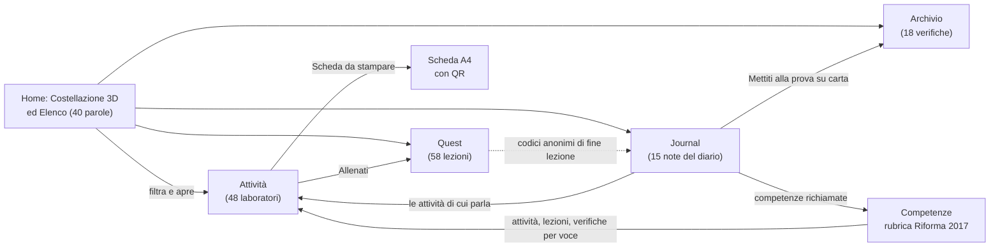

# Orfini Math Lab

**Il laboratorio di matematica dell'Istituto Professionale "E. Orfini" di Foligno, e il suo diario di bordo.**

🌐 **[federicodb.github.io](https://federicodb.github.io/)** · Prof. Federico De Benedictis


Orfini Math Lab è un laboratorio artigianale. Le attività nascono in classe, si provano con gli studenti, si correggono e
a volte si buttano. Il sito raccoglie quello che resta: **48 attività e laboratori**, **58 lezioni di allenamento**,
**15 note del diario di bordo**, **18 verifiche** (**139 voci** in tutto, organizzate attorno a **40 parole chiave**).

---

## L'approccio

- **Gli studenti al centro, senza etichette.** Il sito è uno strumento operativo per chi impara: si apre da un QR, alla
  LIM o sul proprio telefono, e si usa subito. Nessuna attività mostra "per la prima" o "per la quarta". In una quarta
  si può riprendere un'attività pensata per una prima senza far sentire nessuno indietro.
- **Si lavora per competenze, come chiede la legge.** Ogni attività è collegata alle competenze del D.Lgs. 61/2017 e
  del D.M. 92/2018 (asse matematico dell'istruzione professionale) e alle competenze chiave europee. La mappatura non è
  un'etichetta aggiunta dopo: decide come le attività si collegano tra loro e all'allenamento.
- **Vedere, toccare, sbagliare.** Modelli 2D e 3D da manipolare, giochi a livelli con aiuti che si tolgono a poco a
  poco, errori tipici riconosciuti e spiegati invece che solo segnati.
- **A mente, prima di tutto.** Nell'allenamento i numeri si possono sempre gestire a mente. La difficoltà cresce nel
  ragionamento e negli schemi da riconoscere, non nella pesantezza dei conti. La calcolatrice c'è ma conviene non
  usarla: chi risponde a mente prende un bonus, chi la usa non perde niente. Nessun cronometro.
- **Rispetto per chi impara.** Nessun dato personale degli studenti lascia il loro dispositivo. Nelle foto del diario
  non compaiono volti.
- **Aperto, non commerciale.** Solo strumenti open source; codice e contenuti si possono riprendere e migliorare,
  ma nessuno può guadagnarci senza il permesso dell'autore.

---

## Cosa trovi nel sito

| Sezione | Che cos'è |
|---|---|
| **[Esplora — Costellazione ed Elenco](https://federicodb.github.io/)** | La pagina iniziale in due forme: una **nebulosa 3D** interattiva delle 40 parole chiave con *Matematica* (il Sole) al centro, e una **vista Elenco** a dashboard con filtri per sezione, parola chiave e ricerca. |
| **[Allenati](https://federicodb.github.io/allenamento/)** | Orfini Math Quest: lezioni a piccoli passi, dalla prima alla quinta, che funzionano anche offline. |
| **[Journal](https://federicodb.github.io/journal/)** | Il diario di bordo: come nasce un'attività, come è andata in classe, cosa cambia. |
| **[Archivio](https://federicodb.github.io/verifiche.html)** | Le verifiche già svolte, con le loro versioni (file A e B) per mettersi alla prova su carta. |
| **[Calcolo veloce](https://federicodb.github.io/calcolo-mentale.html)** | Le tecniche di calcolo mentale con la loro dimostrazione algebrica ed esercizi senza cronometro. |
| **[Competenze](https://federicodb.github.io/competenze.html)** | La rubrica della Riforma 2017, con le attività, le lezioni e le verifiche per ogni competenza. |
| **[La Scuola](https://federicodb.github.io/scuola.html)** | Il contesto didattico dell'IPIA «E. Orfini» di Foligno e gli indirizzi di studio. |

### Le attività

App HTML autonome: ognuna è un solo file, si apre in un browser e non chiede di installare niente. Molte hanno un
pulsante **Spiegami** che apre una spiegazione animata di circa un minuto. Alcuni esempi, per area:

- **Numeri e aritmetica**: *Arcade Challenge: MCM & MCD* e *Unità di misura* (l'ascensore dei multipli), *Percent Lab*,
  il laboratorio delle frazioni, *Caccia all'errore* sui numeri interi, il labirinto del *Filo di Dedalo*.
- **Algebra**: *Polinomi Challenge 3D*, *AlgebraLab 3D* e *Algebra Tiles* per scomporre i polinomi come volumi,
  le dimostrazioni geometriche dei prodotti notevoli, *Arcade Challenge: Scomposizioni & Parabola*, i memory delle
  scomposizioni e delle condizioni di esistenza.
- **Funzioni, equazioni, disequazioni**: *Math Bubble* (la retta che fa scoppiare le bolle), *Math Pool* (il biliardo
  cartesiano), il laboratorio della parabola e delle disequazioni di secondo grado, *Frazionarie vs sistemi*,
  *Math Underground*, *FuncLab*, le scale logaritmiche, le funzioni goniometriche.
- **Geometria e numeri irrazionali**: π, √2 e φ irrazionali spiegati con ruote, lancette e frazioni di Fibonacci,
  l'albero pitagorico, il metodo di esaustione, la carta di Mercatore, le fasi della Luna.
- **Dati, scelte, modelli**: teoria dei giochi e valutazione consapevole, insiemi e diagrammi di Venn, random walk,
  attrattori e caos, automi cellulari, *Snake of Life* (un serpente che impara da solo).
- **Dalla matematica all'oggetto**: lo *Studio Plotter CNC* trasforma curve, frattali e solidi in G-code per una
  stampante 3D con penna, con esportazione OpenSCAD; *Sketch to Pattern* per l'arte generativa.

La serie **Arcade Challenge** ha uno stile comune: missioni a livelli, monete e indizi, problemi ambientati
nell'indirizzo dello studente (meccanico, elettrico, grafica, moda, odontotecnico, socio-sanitario).

### Allenati: Orfini Math Quest

Lezioni brevi in tre livelli: si scopre un'idea, la si manipola (si trascina, si ordina, si posiziona sulla retta), poi
la si mette alla prova. A ogni partenza i numeri cambiano ma la difficoltà resta la stessa.

- **Contenuti**: numeri, polinomi, equazioni, rette, sistemi, geometria, dati, funzioni, allenamento INVALSI,
  matematica al lavoro per ogni indirizzo, calcolo veloce. Ultime arrivate: la successione di Fibonacci (con i suoi
  invarianti) e il rapporto aureo (con un "vero o leggenda" su natura e architettura).
- **Controlli**: ogni lezione è verificata da test automatici che generano migliaia di esercizi e ne ricalcolano le
  risposte con programmi di calcolo simbolico.
- **Privacy**: i progressi restano sul dispositivo dello studente. A fine lezione compare solo un codice
  anonimo (per esempio `fibonacci·2·80`) da mostrare al docente se lo chiede.

### Journal: il diario di bordo

Note brevi (200-300 parole) su come un'attività è stata usata in classe: perché è nata, cosa è successo, cosa cambia.
Ogni nota ha:

- una parte **per gli studenti**: come usare l'attività per prepararsi a una verifica scritta, a cosa fare
  attenzione, un esercizio con la soluzione a scomparsa e le verifiche vere sugli stessi temi;
- immagini catturate dentro l'attività, in un momento interessante e in tema scuro (mai la schermata d'avvio);
- i temi principali, che portano alla ricerca nel catalogo;
- le competenze richiamate, con il link alla rubrica;
- le attività di cui parla, con "Spiegami", "Allenati" e la scheda da stampare, più altre attività e altre note;
- come è cambiata l'attività nel tempo, in parole semplici;
- quando il docente li raccoglie, gli esiti anonimi delle lezioni di allenamento collegate.

Si scrive in Markdown: un file in `content/journal/`, e il resto lo fa il build.

### La home in due forme: Costellazione 3D ed Elenco

La pagina iniziale presenta le 139 voci del laboratorio in due viste complementari, commutabili dalla barra in alto mantenendo lo stesso filtro:

- **Costellazione (`sito/costellazione.js`)**: una nebulosa in tre dimensioni calcolata dal build (`data/mappa.json`), identica a ogni visita. Al centro splende il Sole (**Matematica**), attorno a cui ruotano le 4 sezioni (*Attività*, *Allenati*, *Journal*, *Archivio*), le 40 stelle delle parole chiave (con colore e forma geometrica della sezione prevalente) e i simboli matematici in KaTeX sullo sfondo di una cupola stellata.
  - **Rotazione inerziale ed elasticità plastica**: trascinando lo sfondo la nebulosa gira e prosegue per inerzia; trascinando una stella, quelle collegate la seguono come molle e al rilascio la costellazione si assesta nella nuova forma finché non si preme *Ricentra*.
  - **Zoom semantico e accessibilità**: da lontano si leggono le sezioni e le parole principali; avvicinandosi (o aprendo un padre) compaiono le parole figlie. Allontanandosi fino al minimo resta visibile solo la parola *Matematica*. Ogni stella è un vero pulsante HTML navigabile da tastiera (`Tab`, `Invio`, `Esc`, frecce) e leggibile dai lettori di schermo.
- **Elenco (`sito/elenco.js`)**: HTML statico generato dal build (`tools/genera.mjs`), leggibile anche senza JavaScript. In alto una dashboard mostra i progressi personali della Quest e le 4 tessere di sezione con contatori che si aggiornano in tempo reale filtrando per parola chiave (con gerarchia padre/figlie) o cercando nel testo (con riconoscimento degli alias del vocabolario e delle forme singolare/plurale).

### La rubrica delle competenze

La pagina **Competenze** mostra la rubrica della Riforma 2017 per l'istruzione professionale e, per ogni voce, le
attività e le lezioni della Quest che la allenano:

- conoscenze (`MAT_K1`-`K4`), abilità (`MAT_A1`-`A4`) e competenze (`MAT_C1`-`C4`) dell'asse matematico;
- competenze chiave di cittadinanza (`CIT_1`-`CIT_8`);
- competenze di indirizzo e trasversali (`IND_…`, `SOFT_…`).

Serve agli studenti per allenarsi su un obiettivo, e ai docenti per vedere come un catalogo nato in classe si legge
dentro quanto previsto dalla legge. I codici stanno nei metadati di ogni attività: catalogo, Journal, Mappa e
allenamenti li usano tutti.

---

## Come si tengono insieme

Le parti del sito non sono pagine separate: il build le collega tra loro, a partire dai metadati di ogni attività
(temi, codici di competenza, allenamenti scelti dal docente).



- **Dall'attività alla Quest**: ogni app propone le lezioni di allenamento scelte dal docente (o nessuna, se
  nessuna c'entra davvero).
- **Dal gioco alla scrittura**: ogni nota del Journal, nella parte per gli studenti, porta alle **verifiche
  dell'Archivio** con esercizi sugli stessi temi: si gioca, poi ci si mette alla prova con carta e penna.
- **Dalla nota alla legge**: le competenze richiamate dall'attività portano alla voce della rubrica; la rubrica,
  a sua volta, mostra per ogni voce le attività, le lezioni e le verifiche che la allenano.
- **Dal tema al catalogo**: nella Mappa un tema accende i temi vicini e le attività che ne parlano; i temi sotto
  il titolo di una nota portano alla ricerca nel catalogo.
- **Dallo schermo alla carta**: ogni attività ha una **scheda A4** da stampare o salvare in PDF, con il QR per
  aprirla, temi, competenze, allenamenti, la parte di studio e uno spazio per gli appunti.
- **Dalla classe al diario**: a fine lezione la Quest mostra un codice anonimo (lezione·livello·percentuale);
  il docente li raccoglie e il Journal ne fa una tabella, senza un solo nome.

---

## Come è costruito

Sito statico su GitHub Pages, senza framework né server. Le app restano file singoli; l'intero sito si costruisce e si valida con un solo comando (`npm run build`, orchestrato da `tools/build.mjs`):

1. **`build.py` (con `dati_build.py`, `journal_build.py`, `mappa_build.py`)**:
   - legge le attività, le lezioni della Quest, le note del Journal e le verifiche, e genera `data/attivita.json` (le 139 voci della home), `database.js` e `sitemap.xml`;
   - genera il **Journal** (`journal/`), le copertine in WebP ripulite dai metadati e le **40 schede A4 da stampare** con QR;
   - aggiorna il colophon di tutte le pagine e segnala eventuali avvisi.
2. **`tools/valida.mjs`**: controlla che ogni voce di `data/attivita.json` e ogni parola o alias di `data/vocabolario.json` siano validi, privi di duplicati e puntino a indirizzi esistenti nel sito.
3. **`tools/mappa.mjs`**: calcola con un algoritmo deterministico le coordinate 3D `(x, y, z)` di sezioni e stelle e scrive `data/mappa.json`.
4. **`tools/genera.mjs`**: scrive la barra unica del menu (`tools/parti/menu.html`) in tutte le pagine, e genera in `index.html` le tessere della dashboard, l'elenco completo delle schede (con formule convertite in MathML tramite KaTeX) e i nodi della costellazione.

Il sito funziona anche **senza rete** per ciò che si è già aperto grazie al service worker (`sw.js`). Il tema scuro (*Lavagna*, predefinito) e il tema chiaro ad alto contrasto (*Carta/LIM*, `sito/tema.css`) sono condivisi tra tutte le pagine e la Quest, insieme all'opzione *Riduci effetti* (`sito/effetti.js`).

**Test**: Playwright per tutte le pagine del sito (`npm run test:home` per elenco e costellazione, `npx playwright test` per l'intera suite), più i test della Quest con verifica simbolica delle risposte (`allenamento/`).

**Strumenti** (tutti open source): Three.js, KaTeX (servito localmente), Nerdamer, math.js, p5.js, D3, JSXGraph, Chart.js, Tailwind CSS, Python con Pillow e Markdown, Node.js, Playwright.

### Per aggiungere qualcosa

La guida passo-passo è in [`docs/come-aggiungere-attivita.md`](docs/come-aggiungere-attivita.md):

- **Un'attività**: aggiungere il file HTML in `content/apps/` con `<meta name="parole" content="...">` (usando gli `id` di `data/vocabolario.json`), titolo, descrizione e `<meta name="allenamento">`; poi lanciare `npm run build`.
- **Una nota del Journal**: copiare `content/journal/_modello.md`, scrivere la nota e lanciare `npm run build`.
- **Una lezione della Quest**: copiare `allenamento/activities/_modello.js`, includere `descrizione` e `parole`, importarla in `allenamento/activities/catalogo.js` e lanciare `npm run build`.

Build completo e anteprima locale (senza servizi esterni):

```bash
npm run build                 # genera catalogo, Journal, mappa 3D, menu e home, e valida tutto
python3 -m http.server 8080   # anteprima su http://localhost:8080/
npm run test:home             # esegue i test Playwright di Elenco e Costellazione
```

---

## Licenza

Tutto il progetto, **codice e contenuti**, è distribuito con licenza
[CC BY-NC-SA 4.0](https://creativecommons.org/licenses/by-nc-sa/4.0/deed.it) (vedi [LICENSE](LICENSE)):

- si può copiare, modificare e usare liberamente in classe e nella formazione, **citando l'autore**;
- **non si può usare a scopo di lucro** (vendita, pubblicazioni e corsi a pagamento, prodotti editoriali) senza
  il permesso scritto dell'autore, che si può chiedere e concedere caso per caso;
- chi trasforma il materiale lo condivide con la stessa licenza.

Le librerie di terzi restano sotto le loro licenze. Le versioni pubblicate prima del 31 ottobre 2026 erano dichiarate
con licenza MIT.

---

**Prof. Federico De Benedictis** · Istituto Professionale Statale "E. Orfini", Foligno ·
Instagram [@meltingmath](https://instagram.com/meltingmath)
