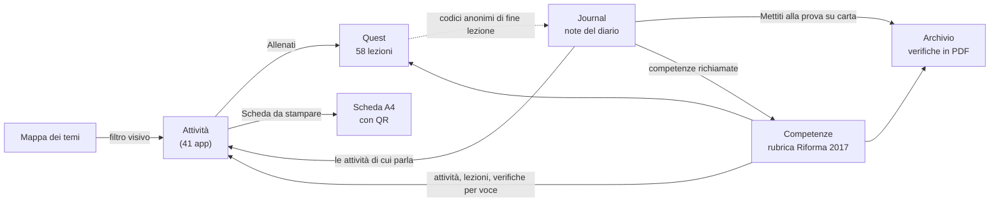

# Orfini Math Lab

**Il laboratorio di matematica dell'Istituto Professionale "E. Orfini" di Foligno, e il suo diario di bordo.**

🌐 **[federicodb.github.io](https://federicodb.github.io/)** · Prof. Federico De Benedictis


Orfini Math Lab è un laboratorio artigianale. Le attività nascono in classe, si provano con gli studenti, si correggono e
a volte si buttano. Il sito raccoglie quello che resta: **41 attività interattive**, **58 lezioni di allenamento**,
**18 verifiche**, **10 spiegazioni animate**. C'è anche il quaderno di lavoro che racconta come sono nate e come sono andate.

---

## L'approccio

- **Gli studenti al centro, senza etichette.** Il sito è uno strumento operativo per chi impara: si apre da un QR, alla
  LIM o sul proprio telefono, e si usa subito. Nessuna attività mostra "per la prima" o "per la quarta". In una quarta
  si può riprendere un'attività pensata per una prima senza far sentire nessuno indietro.
- **Si lavora per competenze, come chiede la legge.** Ogni attività è collegata alle competenze del D.Lgs. 61/2017 e
  del D.M. 92/2018 (asse matematico dell'istruzione professionale) e alle competenze chiave europee. La mappatura non è
  un'etichetta aggiunta dopo: decide come le attività si collegano tra loro e all'allenamento.
- **Vedere, toccare, sbagliare.** Modelli 2D e 3D da manipolare, giochi a livelli con aiuti che si tolgono a poco a
  poco, errori tipici riconosciuti e spiegati invece che solo segnati.
- **A mente, prima di tutto.** Nell'allenamento i numeri si possono sempre gestire a mente. La difficoltà cresce nel
  ragionamento e negli schemi da riconoscere, non nella pesantezza dei conti. La calcolatrice c'è ma conviene non
  usarla: chi risponde a mente prende un bonus, chi la usa non perde niente. Nessun cronometro.
- **Rispetto per chi impara.** Nessun dato personale degli studenti lascia il loro dispositivo. Nelle foto del diario
  non compaiono volti.
- **Aperto.** Solo strumenti open source, codice e contenuti liberi di essere ripresi e migliorati.

---

## Cosa trovi nel sito

| Sezione | Che cos'è |
|---|---|
| **[Attività](https://federicodb.github.io/)** | Il catalogo delle app, con ricerca e filtri (arcade, simulazioni, memory, infografiche). |
| **[Allenati](https://federicodb.github.io/allenamento/)** | Orfini Math Quest: lezioni a piccoli passi, dalla prima alla quinta, che funzionano anche offline. |
| **[Calcolo veloce](https://federicodb.github.io/calcolo-mentale.html)** | Le tecniche di calcolo mentale con la loro dimostrazione. |
| **[Journal](https://federicodb.github.io/journal/)** | Il diario di bordo: come nasce un'attività, come è andata in classe, cosa cambia. |
| **[Mappa](https://federicodb.github.io/galaxy.html)** | La mappa stellare dei temi: un filtro visivo su tutto il laboratorio. |
| **[Competenze](https://federicodb.github.io/competenze.html)** | La rubrica della Riforma 2017, con le attività e le lezioni per ogni competenza. |
| **[Archivio](https://federicodb.github.io/verifiche.html)** | Le verifiche, con le loro versioni (file A e B). |

### Le attività

App HTML autonome: ognuna è un solo file, si apre in un browser e non chiede di installare niente. Molte hanno un
pulsante **Spiegami** che apre una spiegazione animata di circa un minuto. Alcuni esempi, per area:

- **Numeri e aritmetica**: *Arcade Challenge: MCM & MCD* e *Unità di misura* (l'ascensore dei multipli), *Percent Lab*,
  il laboratorio delle frazioni, *Caccia all'errore* sui numeri interi, il labirinto del *Filo di Dedalo*.
- **Algebra**: *Polinomi Challenge 3D*, *AlgebraLab 3D* e *Algebra Tiles* per scomporre i polinomi come volumi,
  le dimostrazioni geometriche dei prodotti notevoli, *Arcade Challenge: Scomposizioni & Parabola*, i memory delle
  scomposizioni e delle condizioni di esistenza.
- **Funzioni, equazioni, disequazioni**: *Math Bubble* (la retta che fa scoppiare le bolle), *Math Pool* (il biliardo
  cartesiano), il laboratorio della parabola e delle disequazioni di secondo grado, *Frazionarie vs sistemi*,
  *Math Underground*, *FuncLab*, le scale logaritmiche, le funzioni goniometriche.
- **Geometria e numeri irrazionali**: π, √2 e φ irrazionali spiegati con ruote, lancette e frazioni di Fibonacci,
  l'albero pitagorico, il metodo di esaustione, la carta di Mercatore, le fasi della Luna.
- **Dati, scelte, modelli**: teoria dei giochi e valutazione consapevole, insiemi e diagrammi di Venn, random walk,
  attrattori e caos, automi cellulari, *Snake of Life* (un serpente che impara da solo).
- **Dalla matematica all'oggetto**: lo *Studio Plotter CNC* trasforma curve, frattali e solidi in G-code per una
  stampante 3D con penna, con esportazione OpenSCAD; *Sketch to Pattern* per l'arte generativa.

La serie **Arcade Challenge** ha uno stile comune: missioni a livelli, monete e indizi, problemi ambientati
nell'indirizzo dello studente (meccanico, elettrico, grafica, moda, odontotecnico, socio-sanitario).

### Allenati: Orfini Math Quest

Lezioni brevi in tre livelli: si scopre un'idea, la si manipola (si trascina, si ordina, si posiziona sulla retta), poi
la si mette alla prova. A ogni partenza i numeri cambiano ma la difficoltà resta la stessa.

- **Contenuti**: numeri, polinomi, equazioni, rette, sistemi, geometria, dati, funzioni, allenamento INVALSI,
  matematica al lavoro per ogni indirizzo, calcolo veloce. Ultime arrivate: la successione di Fibonacci (con i suoi
  invarianti) e il rapporto aureo (con un "vero o leggenda" su natura e architettura).
- **Controlli**: ogni lezione è verificata da test automatici che generano migliaia di esercizi e ne ricalcolano le
  risposte con programmi di calcolo simbolico.
- **Privacy**: i progressi restano sul dispositivo dello studente. A fine lezione compare solo un codice
  anonimo (per esempio `fibonacci·2·80`) da mostrare al docente se lo chiede.

### Journal: il diario di bordo

Note brevi (200-300 parole) su come un'attività è stata usata in classe: perché è nata, cosa è successo, cosa cambia.
Ogni nota ha:

- una parte **per gli studenti**: come usare l'attività per prepararsi a una verifica scritta, a cosa fare
  attenzione, un esercizio con la soluzione a scomparsa e le verifiche vere sugli stessi temi;
- immagini catturate dentro l'attività, in un momento interessante e in tema scuro (mai la schermata d'avvio);
- i temi principali, che portano alla ricerca nel catalogo;
- le competenze richiamate, con il link alla rubrica;
- le attività di cui parla, con "Spiegami", "Allenati" e la scheda da stampare, più altre attività e altre note;
- come è cambiata l'attività nel tempo, in parole semplici;
- quando il docente li raccoglie, gli esiti anonimi delle lezioni di allenamento collegate.

Si scrive in Markdown: un file in `content/journal/`, e il resto lo fa il build.

### La mappa stellare dei temi

Tutti i temi delle attività in una costellazione 3D, con *Matematica* al centro:

- **Temi e legami**: ogni tema è un neurone luminoso, grande quanto il numero di attività che ne parlano. I legami
  uniscono i temi che compaiono insieme, e un impulso di luce li percorre come un segnale nervoso.
- **Famiglie**: i temi vicini per argomento formano famiglie dello stesso colore. Nessun tema resta isolato.
- **Filtro visivo**: tocchi un tema e restano accesi i temi e le attività collegate; tocchi un secondo tema e il filtro
  si restringe all'intersezione. Dal pannello si apre l'attività o il catalogo già filtrato.
- **Si gioca**: si trascina un tema e i vicini lo seguono come molle; allontanandosi resta leggibile solo
  *Matematica* al centro della costellazione.

### La rubrica delle competenze

La pagina **Competenze** mostra la rubrica della Riforma 2017 per l'istruzione professionale e, per ogni voce, le
attività e le lezioni della Quest che la allenano:

- conoscenze (`MAT_K1`-`K4`), abilità (`MAT_A1`-`A4`) e competenze (`MAT_C1`-`C4`) dell'asse matematico;
- competenze chiave di cittadinanza (`CIT_1`-`CIT_8`);
- competenze di indirizzo e trasversali (`IND_…`, `SOFT_…`).

Serve agli studenti per allenarsi su un obiettivo, e ai docenti per vedere come un catalogo nato in classe si legge
dentro quanto previsto dalla legge. I codici stanno nei metadati di ogni attività: catalogo, Journal, Mappa e
allenamenti li usano tutti.

---

## Come si tengono insieme

Le parti del sito non sono pagine separate: il build le collega tra loro, a partire dai metadati di ogni attività
(temi, codici di competenza, allenamenti scelti dal docente).



- **Dall'attività alla Quest**: ogni app propone le lezioni di allenamento scelte dal docente (o nessuna, se
  nessuna c'entra davvero).
- **Dal gioco alla scrittura**: ogni nota del Journal, nella parte per gli studenti, porta alle **verifiche
  dell'Archivio** con esercizi sugli stessi temi: si gioca, poi ci si mette alla prova con carta e penna.
- **Dalla nota alla legge**: le competenze richiamate dall'attività portano alla voce della rubrica; la rubrica,
  a sua volta, mostra per ogni voce le attività, le lezioni e le verifiche che la allenano.
- **Dal tema al catalogo**: nella Mappa un tema accende i temi vicini e le attività che ne parlano; i temi sotto
  il titolo di una nota portano alla ricerca nel catalogo.
- **Dallo schermo alla carta**: ogni attività ha una **scheda A4** da stampare o salvare in PDF, con il QR per
  aprirla, temi, competenze, allenamenti, la parte di studio e uno spazio per gli appunti.
- **Dalla classe al diario**: a fine lezione la Quest mostra un codice anonimo (lezione·livello·percentuale);
  il docente li raccoglie e il Journal ne fa una tabella, senza un solo nome.

---

## Come è costruito

Sito statico su GitHub Pages, senza framework né server. Le app restano file singoli; tutto ciò che collega le parti lo
genera uno script Python, `build.py`:

- **legge** le attività (metadati delle pagine, codici di competenza, data) e scrive il catalogo (`database.js`), la
  sitemap e il blocco SEO della home;
- **collega** ogni attività alle lezioni di allenamento scelte dal docente (`<meta name="allenamento">`);
- **genera il Journal** (`journal_build.py`): pagine delle note, copertine controllate e ripulite dai metadati,
  temi, competenze, verifiche collegate, storia delle attività, esiti anonimi; e le **schede da stampare**;
- **genera la Mappa** (`mappa_build.py`): temi, legami, famiglie;
- **scrive il colophon** di tutte le pagine (licenze, ultimo aggiornamento);
- **controlla e avvisa**: metadati mancanti, immagini chiare o senza descrizione, librerie senza versione.

Il sito funziona anche **senza rete** per ciò che si è già aperto: lo gestisce un service worker. Le librerie esterne
sono caricate da CDN con la versione fissa; il JSX delle app React è tradotto in anticipo (`tools/compila_jsx.mjs`),
così il browser non deve scaricare un compilatore.

**Test**: Playwright per le pagine del sito (`tests/`), test della Quest con verifica simbolica delle risposte
(`allenamento/`, `npm test`).

**Strumenti** (tutti open source): Three.js, KaTeX, Nerdamer, math.js, p5.js, D3, JSXGraph, Chart.js, Tailwind CSS,
Python con Pillow e Markdown, Playwright.

### Per aggiungere qualcosa

- **Un'attività**: un file HTML in `content/apps/` con titolo, descrizione, parole chiave (anche i codici di competenza)
  e il meta degli allenamenti; poi la miniatura e il build.
- **Una nota del Journal**: copiare `content/journal/_modello.md`, scrivere, rilanciare il build.
- **Una lezione della Quest**: copiare `allenamento/activities/_modello.js` e importarla in `activities/catalogo.js`.

Build senza servizi esterni:

```bash
.venv/bin/python3 -c "import build; build.GEMINI_API_KEY=''; build.main()"
python3 -m http.server 8080   # anteprima su http://localhost:8080/
```

---

## Licenze

- **Codice** (app, script, build): [MIT](LICENSE).
- **Contenuti** (testi, note, spiegazioni, schede, verifiche, immagini):
  [CC BY-SA 4.0](https://creativecommons.org/licenses/by-sa/4.0/deed.it), vedi [LICENSE-CONTENUTI](LICENSE-CONTENUTI).
  Si possono riusare anche in classe, citando l'autore e condividendo alle stesse condizioni.
- Le librerie di terzi restano sotto le loro licenze.

---

**Prof. Federico De Benedictis** · Istituto Professionale Statale "E. Orfini", Foligno ·
Instagram [@meltingmath](https://instagram.com/meltingmath)
