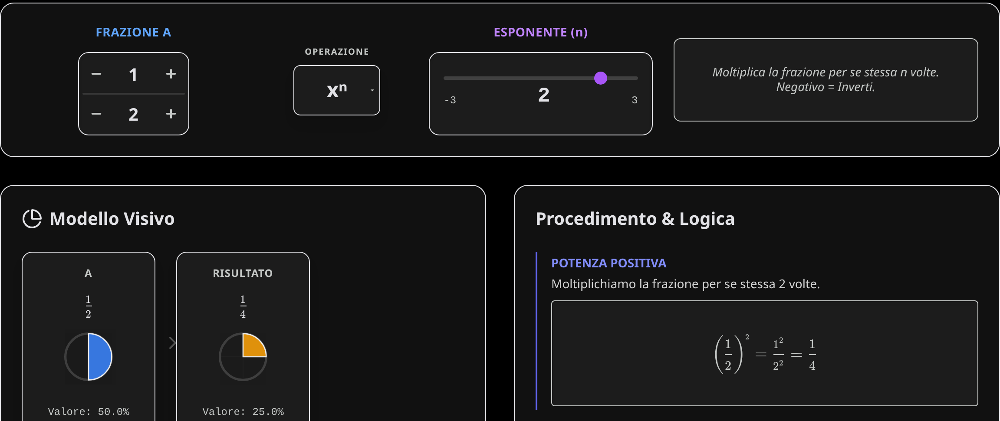
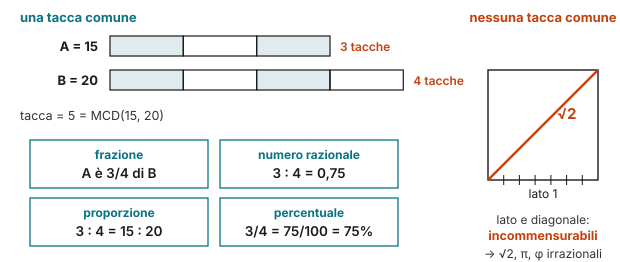

## Cosa è

Un laboratorio per vedere che cosa *fanno* le operazioni alle frazioni. Si sceglie la frazione A e la frazione B con i pulsanti $+$ e $-$ su numeratore e denominatore, si sceglie l'operazione ($+$, $-$, $\times$, $\div$ oppure la potenza $x^n$) e l'app mostra tre cose insieme:

- il **modello visivo**: A, B e il risultato come torte, con il valore in percentuale;
- la **retta numerica**, da $-1$ a $2$, con i tre punti A, B e risultato;
- il **procedimento**, passo per passo, con il concetto chiave dell'operazione.

Con la potenza un cursore porta l'esponente da $-3$ a $3$, zero compreso.

## L'idea matematica

Per sommare servono fette della stessa misura. In $\frac12 + \frac13$ le metà e i terzi non si possono contare insieme: si passa ai sesti, perché $\text{mcm}(2, 3) = 6$.

$$\frac12 + \frac13 = \frac36 + \frac26 = \frac56$$

Moltiplicare invece è "prendere una parte di": $\frac23 \cdot \frac34$ sono i due terzi di tre quarti, come l'area di un rettangolo. Dividere è chiedersi quante volte una frazione sta nell'altra: dividere per $\frac12$ è raddoppiare. E la potenza ha due casi da vedere:

$$\left(\frac12\right)^{2} = \frac14 \qquad \left(\frac12\right)^{-2} = 2^2 = 4 \qquad \left(\frac12\right)^{0} = 1$$

L'esponente negativo inverte la frazione, "come una retromarcia", dice l'app.

## Quattro facce dello stesso discorso

Prendi due bastoncini, uno lungo $15$ e uno lungo $20$, e un righello senza numeri: ha una sola tacca, che puoi riportare quante volte vuoi. Esiste una tacca che stia un numero **intero** di volte in tutti e due? Sì: una tacca lunga $5$ entra $3$ volte nel primo e $4$ nel secondo. Quando succede, i due bastoncini si dicono **commensurabili**: hanno una misura in comune.

Per trovare la tacca c'è un trucco vecchio di duemila anni, l'**algoritmo di Euclide**: si toglie il bastoncino corto da quello lungo finché i due pezzi non diventano uguali. $20 - 15 = 5$, poi $15 - 5 = 10$, $10 - 5 = 5$: la tacca è $5$, cioè il **MCD**. È la stessa idea della teglia da tagliare nell'[Arcade MCM & MCD](../2026-10-25-arcade-challenge-mcm-mcd/).

Trovata la tacca, la stessa coppia si può raccontare in quattro modi. Sono quattro facce dello stesso discorso:

- **Frazione**: il primo contiene la tacca 3 volte, il secondo 4: il primo è $\frac34$ del secondo. Il denominatore dice in quante tacche è diviso l'intero, il numeratore quante ne prendiamo.
- **Numero razionale**: lo stesso rapporto scritto come numero, $3 : 4 = 0{,}75$, un punto preciso della retta. Ogni coppia commensurabile dà un razionale, e ogni razionale nasce così: è il significato di $\mathbb{Q}$, e il motivo per cui il suo decimale è finito o periodico.
- **Proporzione**: ingrandisci tutto, come una ricetta per più persone o una mappa in scala, e la tacca cresce con te: $3 : 4 = 15 : 20 = 30 : 40$. Cambia la scala, non il rapporto. Le [equivalenze dell'ascensore](../2026-10-26-arcade-challenge-unita-di-misura/) sono proporzioni con il $10$; la lezione [Proporzioni](/allenamento/#/lezione/proporzioni/1) le allena.
- **Percentuale**: scegli una tacca speciale, quella che sta **100** volte nell'intero. Allora $\frac34 = \frac{75}{100} = 75\%$. Una percentuale è una proporzione con il 100 in fondo: $x : 100 = 3 : 4$. Si allena nel [Percent Lab](/content/apps/percentuali_001.html), nella lezione [Percentuali](/allenamento/#/lezione/percentuali/1) e con due trucchi del calcolo veloce: [le percentuali che si scambiano](/calcolo-mentale.html#percentuali-scambiate) ($8\%$ di $25$ è il $25\%$ di $8$) e [per 25 come diviso 4](/calcolo-mentale.html#per-5-e-25).

E poi c'è il rovescio della medaglia. Prova con il lato e la diagonale di un quadrato: l'algoritmo di Euclide non finisce mai, i pezzi diventano sempre più piccoli senza mai diventare uguali. **Nessuna tacca** li misura tutti e due: sono **incommensurabili**, e il loro rapporto, $\sqrt2$, non è una frazione. Da qui nascono gli irrazionali: [π](../2026-10-28-pi-greco-non-e-una-frazione/) tra diametro e circonferenza, [φ](../2026-10-30-phi-e-le-frazioni-di-fibonacci/) nel rapporto aureo, e la diagonale che si incontra nel [teorema di Pitagora](../2026-11-01-il-teorema-di-pitagora-nell-albero/).

## Per prepararti alla verifica

- Prima di calcolare, prevedi: il risultato sarà più grande o più piccolo di A? Poi controlla sulla retta. Moltiplicare per una frazione minore di 1 **rimpicciolisce**, dividere **ingrandisce**.
- Da sapere: mcm per sommare, prodotto in croce per confrontare, reciproco per dividere, esponente negativo che inverte.
- Quando le operazioni ti sono chiare qui, allenale a mente nel **Filo di Dedalo**: i sigilli del labirinto chiedono frazioni, percentuali e proporzioni senza torte né retta, e senza tempo per scrivere.
- **Attenzione**: non si sommano i denominatori ($\frac12 + \frac13 \neq \frac25$) e il risultato va sempre semplificato.

**Prova tu.** Calcola $\frac34 - \frac16$ e $\left(\frac23\right)^{-2}$. Il primo risultato è più grande o più piccolo di $\frac12$?

Soluzione

$\text{mcm}(4, 6) = 12$: $\frac{9}{12} - \frac{2}{12} = \frac{7}{12}$, poco più di $\frac12 = \frac{6}{12}$. Poi $\left(\frac23\right)^{-2} = \left(\frac32\right)^2 = \frac94$.

## Come usarla in classe

Alla LIM si fissa A e si cambia solo B, un passo alla volta, chiedendo alla classe di prevedere dove finirà il punto arancio del risultato sulla retta: è il modo più rapido per accorgersi che $\frac12 \cdot \frac12$ è *più piccolo* di $\frac12$. Con la potenza si trascina il cursore da $3$ a $-3$ e si guarda la torta riempirsi e poi "uscire" dall'intero quando l'esponente diventa negativo.

Il procedimento a destra si può copiare sul quaderno così com'è: è lo stesso che si scrive in verifica. Per allenarsi: **Frazioni** e **Proprietà delle potenze**; la scheda da stampare riassume regole ed esercizi.

Il passo dopo è **Il filo di Dedalo**. Fractions Lab fa *vedere* le operazioni; nel labirinto le stesse operazioni vanno *usate*, a mente, per aprire i sigilli mentre il Minotauro avanza. Funziona bene in due tempi: prima il laboratorio alla LIM, poi una partita in modalità **Classe**, a squadre, dove chi apre un sigillo spiega alla squadra il ragionamento. Se un sigillo blocca la squadra, si torna a Fractions Lab e lo si guarda in torte e sulla retta.

## A cosa fare attenzione

- **Somma dei denominatori**: è l'errore più tenace, e la torta lo smonta meglio di ogni regola.
- **Denominatore zero**: l'app lo segnala come divisione per zero; vale la pena chiedere perché.
- **Percentuale e frazione**: la torta mostra anche il valore in percentuale, un ponte naturale verso il Percent Lab.
