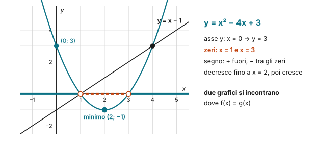
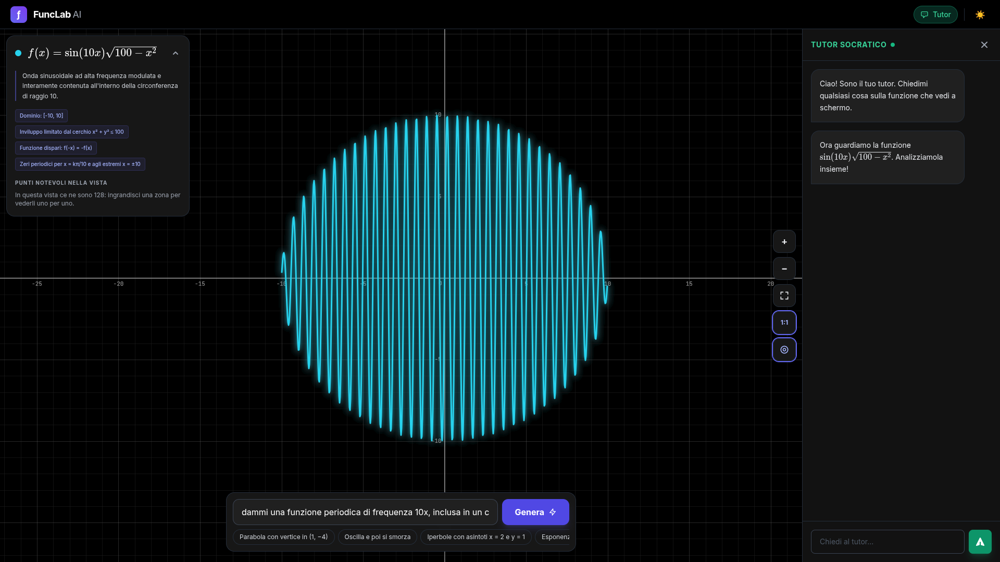

## Cosa è

**FuncLab** è un esploratore di funzioni con l'intelligenza artificiale: si descrive una funzione a parole, si preme **Genera** e la funzione compare sul piano, con una scheda che ne riassume le proprietà. Il piano si trascina e si ingrandisce con la rotella (con Shift solo l'asse $x$, con Alt solo l'asse $y$); un clic sulla curva fissa un punto. A destra c'è il **tutor socratico**: non dà le risposte, fa domande sulla funzione che si vede.

## Che cos'è una funzione

Una **funzione** $f$ è una regola che a **ogni** numero $x$ di un insieme associa **uno e un solo** numero $y = f(x)$. Le due parole che contano sono "ogni" e "uno solo": una $x$ non può restare senza risposta, né averne due.

- Il **dominio** è l'insieme delle $x$ per cui la regola ha senso: per $\frac{1}{x}$ si esclude $0$, per $\sqrt{x}$ i numeri negativi.
- Il **codominio** è l'insieme in cui cerchiamo i risultati: per le funzioni della scuola, di solito tutti i numeri reali $\mathbb{R}$.
- L'**immagine** è l'insieme dei valori che la funzione **raggiunge davvero**: è contenuta nel codominio, ma spesso è più piccola.

Il **grafico** è l'insieme dei punti $(x;\ f(x))$: studiare una funzione vuol dire capire com'è fatto il grafico prima di disegnarlo.

## Lo studio, passo per passo, su una parabola

Prendiamo $f(x) = x^2 - 4x + 3$.

1. **Dominio**: è un polinomio, si può calcolare per ogni $x$: il dominio è $\mathbb{R}$.
2. **Intersezione con l'asse $y$**: è il punto in cui $x = 0$. Si calcola $f(0) = 3$: il punto è $(0;\ 3)$.
3. **Intersezioni con l'asse $x$ (zeri)**: sono i punti in cui $y = 0$. Si risolve $x^2 - 4x + 3 = 0$, cioè $(x - 1)(x - 3) = 0$: gli zeri sono $x = 1$ e $x = 3$.
4. **Segno**: dove il grafico sta sopra l'asse ($f(x) > 0$) e dove sotto ($f(x) < 0$). La parabola è rivolta verso l'alto, quindi è positiva per $x < 1$ oppure $x > 3$, negativa per $1 < x < 3$.
5. **Crescenza e decrescenza**: una funzione è **crescente** in un intervallo se, prese due $x$ qualunque in quell'intervallo con $x_1 < x_2$, si ha $f(x_1) < f(x_2)$: andando verso destra il grafico sale. È **decrescente** se scende. Qui il vertice ha $x = -\frac{b}{2a} = 2$ e $f(2) = -1$: la funzione decresce per $x \leq 2$ e cresce per $x \geq 2$.
6. **Minimo e immagine**: il punto più basso è il vertice $(2;\ -1)$, un **minimo**. La funzione raggiunge $-1$ e tutti i valori più grandi, ma nessuno più piccolo: l'immagine è $y \geq -1$, mentre il codominio resta $\mathbb{R}$.

Due grafici si incontrano dove hanno la stessa $y$: per la retta $y = x - 1$ si risolve $x^2 - 4x + 3 = x - 1$ e si trovano i punti $(1;\ 0)$ e $(4;\ 3)$.

## Un'onda chiusa in un cerchio

In FuncLab abbiamo chiesto: *"dammi una funzione periodica di frequenza 10x, inclusa in un cerchio di raggio 10"*. FuncLab ha proposto

$$f(x) = \sin(10x)\,\sqrt{100 - x^2}$$

e le stesse domande funzionano anche qui:

- **Dominio**: la radice esiste solo se $100 - x^2 \geq 0$, cioè $-10 \leq x \leq 10$.
- **Immagine e inviluppo**: $|\sin(10x)| \leq 1$, quindi $|f(x)| \leq \sqrt{100 - x^2}$, cioè $x^2 + y^2 \leq 100$: l'onda non esce mai dal cerchio di raggio 10, e l'immagine è contenuta tra $-10$ e $10$.
- **Simmetria**: il seno è dispari e la radice è pari, quindi $f(-x) = -f(x)$: la funzione è **dispari**.
- **Zeri**: dove $\sin(10x) = 0$, cioè $x = \frac{k\pi}{10}$, più gli estremi $x = \pm 10$.
- **Periodo** del seno: $\frac{2\pi}{10} = \frac{\pi}{5} \approx 0{,}63$: per questo le oscillazioni sono così fitte, e la crescenza cambia decine di volte.

È lo stesso percorso di **Math Underground**: una radice di indice pari decide il dominio, una funzione goniometrica porta la periodicità, e il prodotto eredita le proprietà di entrambe.

## Il dialogo con il tutor

La scheda che FuncLab mette accanto al grafico riassume le proprietà: *dominio $[-10, 10]$*, *inviluppo limitato dal cerchio $x^2 + y^2 \leq 100$*, *funzione dispari*, *zeri periodici per $x = \frac{k\pi}{10}$ e agli estremi $x = \pm 10$*, e avverte che nella vista ci sono 128 punti notevoli: per vederli uno per uno bisogna ingrandire. Il tutor apre così:

> *Ciao! Sono il tuo tutor. Chiedimi qualsiasi cosa sulla funzione che vedi a schermo.*
>
> *Ora guardiamo la funzione $\sin(10x)\sqrt{100 - x^2}$. Analizziamola insieme!*

Da qui la parola passa alla classe: ogni proprietà della scheda è una domanda da fare al tutor, e una verifica da fare con i conti della sezione precedente.

## Per prepararti alla verifica

- Lo studio di funzione segue sempre lo stesso ordine: tipo di funzione, dominio, simmetrie, intersezioni con gli assi, segno, asintoti, crescenza. Scrivilo come scaletta prima di cominciare.
- Usa FuncLab per **controllare** il tuo studio, non per farlo: prima i conti, poi il grafico.
- **Attenzione**: l'intelligenza artificiale può sbagliare una formula o una proprietà. Ogni affermazione della scheda di FuncLab si può verificare con un conto, come quelle qui sopra.

**Prova tu.** Studia $g(x) = \sqrt{9 - x^2}$: dominio, simmetria, intersezioni con gli assi. Che figura è il suo grafico?

Soluzione

Dominio: $9 - x^2 \geq 0$, cioè $-3 \leq x \leq 3$. È pari: $g(-x) = g(x)$. Asse $y$: $g(0) = 3$; zeri: $x = \pm 3$. Da $y = \sqrt{9 - x^2}$ si ha $x^2 + y^2 = 9$ con $y \geq 0$: è la semicirconferenza superiore di raggio 3.

## Come usarla in classe

Alla LIM si fa scrivere alla classe la descrizione della funzione da chiedere, poi si studia insieme quella che FuncLab propone: la scheda di FuncLab diventa un elenco di affermazioni da **verificare**, una per una. Il tutor si può interrogare a turno, a voce alta, e la classe giudica se le sue domande portano avanti il ragionamento.

Per classificare la funzione prima di studiarla c'è **Math Underground**; per il segno della parabola, **Parabola e disequazioni di secondo grado**. Per allenarsi: **Funzioni lineari**, **La parabola**, **Studio di funzione**. La scheda da stampare raccoglie lo studio di funzione in sette passi.

## A cosa fare attenzione

- **La fiducia nell'AI**: FuncLab disegna bene, ma la scheda che accompagna il grafico va verificata. È proprio lì il valore didattico.
- **Le descrizioni ambigue**: "frequenza 10x" si può leggere in modi diversi. Chiedere alla classe che cosa intendeva è già matematica.
- **La connessione**: FuncLab gira su Google AI Studio e ha bisogno della rete.
