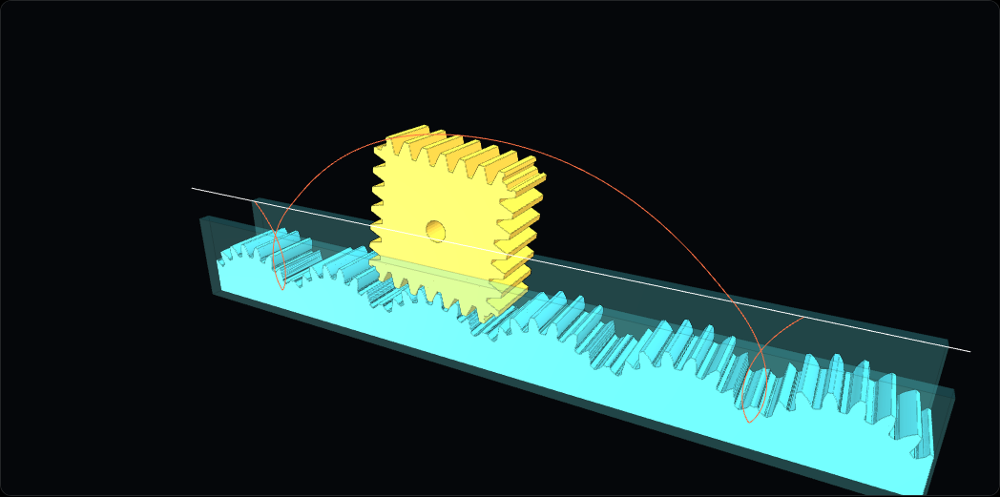
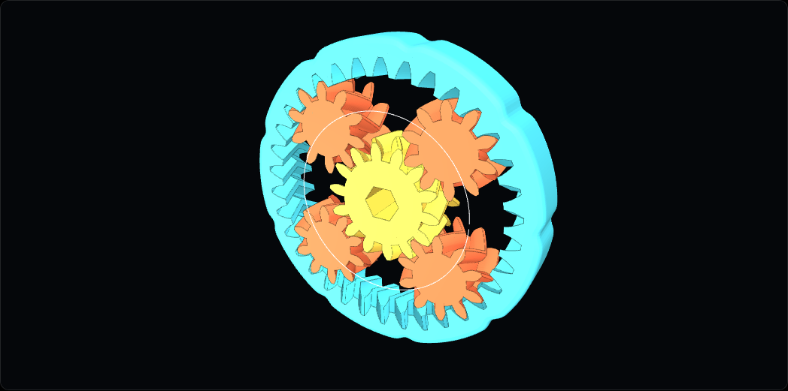

## Cosa è

Un generatore di **cinematismi**, meccanismi che trasformano un moto in un altro, da vedere in 3D e da stampare. Ce ne sono cinque:

- la **ruota quadrata** dentata, che rotola su una guida a gobbe con le sponde;
- il **triangolo di Reuleaux** che gira dentro un foro quadrato;
- due **rulli di Reuleaux** sotto una piattaforma che resta in piano;
- un **planetario** a denti a V, stampato in un pezzo solo e già montato;
- la **coppia di Cardano**, un ingranaggio che rotola dentro una corona e fa disegnare una retta a un punto.

Si sceglie la stampante, si cambiano i parametri, si guarda il moto con il grafico accanto e si scaricano i pezzi pronti da stampare, oppure il codice OpenSCAD per leggerli e modificarli.

## L'idea matematica: compensare una rotazione

Una ruota rotonda su una strada piatta tiene il centro sempre alla stessa altezza. Un quadrato no: se il lato è $10$ cm, il centro sta a $5$ cm da terra quando il quadrato poggia su un lato, e sale a mezza diagonale, $5\sqrt2 \approx 7$ cm, quando poggia su uno spigolo. Per eliminare i sobbalzi si cambia la strada: ogni gobba è un pezzo di **catenaria** capovolta,

$$y = -a\cosh\frac{x}{a}, \qquad \cosh x = \frac{e^x + e^{-x}}{2},$$

dove $a$ è metà del lato. È la stessa curva di una catenella appesa per i due capi. La funzione $\cosh$ è **pari** e ha il minimo $1$ in $x = 0$: la gobba è simmetrica e il suo punto più alto sta proprio sotto il centro della ruota. Una gobba è lunga $L \cdot \ln(1 + \sqrt2)$: per un lato di $32$ mm, circa $28{,}2$ mm.

Negli altri meccanismi a compensare la rotazione è un'altra idea:

- **Reuleaux**: la larghezza è la stessa, $W$, in ogni direzione. Per questo il triangolo tocca sempre i quattro lati del foro, e la piattaforma sui rulli non si inclina. Il perimetro è $\pi W$, come quello del cerchio (teorema di Barbier).
- **Planetario**: con la corona ferma, i satelliti girano attorno al sole in **proporzione** ai giri del sole. Con sole da $14$ denti e corona da $34$ si ha $\frac{14}{14 + 34} = \frac{14}{48} \approx 0{,}29$ giri dei satelliti per ogni giro del sole (formula di Willis).
- **Cardano**: se la corona ha raggio doppio dell'ingranaggio, un punto del bordo si muove su $x = R\cos\theta$, $y = 0$, cioè su un diametro: un moto circolare diventa rettilineo.

Per vederlo in movimento c'è la [spiegazione animata](/content/apps/ruota_quadrata_cinematismi_spiegazione.html), una scena per meccanismo; le regole e cinque esercizi sono nella [scheda da stampare](/schede/ruota_quadrata_cinematismi.html).

**Il filo rosso.** La ruota quadrata è il rovescio della [ruota che misura π](../2026-10-28-pi-greco-non-e-una-frazione/): lì la strada è piatta e la ruota rotonda, qui è la strada a cambiare forma. Lo spigolo del quadrato sta a mezza diagonale dal centro, e la diagonale è quella del [teorema di Pitagora](../2026-11-01-il-teorema-di-pitagora-nell-albero/). Parità, minimo e simmetria di $\cosh$ sono le domande dello [studio di funzione](../2026-11-01-lo-studio-di-funzione-con-funclab/). E il planetario si monta solo se la somma dei denti di sole e corona si divide per il numero di satelliti: è aritmetica da [MCM e MCD](../2026-10-25-arcade-challenge-mcm-mcd/): multipli e divisori decidono se i denti tornano al loro posto.

## Per prepararti alla verifica

- Guarda il **grafico** accanto alla vista 3D: per la ruota quadrata confronta la quota del centro su strada piatta, che sale e scende, con quella sulla guida a catenarie, che resta costante. Prova a cambiare il numero di lati e osserva come cambia la strada.
- Sapere **riconoscere una funzione pari** (simmetrica rispetto all'asse $y$) e **leggere un minimo** sul grafico serve qui come in ogni studio di funzione.
- Nel planetario il rapporto tra i giri è una **proporzione**: se raddoppi i giri del sole, raddoppiano quelli dei satelliti.
- **Attenzione**: nella formula di Willis al denominatore ci sono i denti del sole **più** quelli della corona, non solo quelli della corona.

**Prova tu.** Un planetario ha il sole da $16$ denti e i satelliti da $8$. Quanti denti ha la corona? Con $4$ satelliti si può montare? Quanti giri fanno i satelliti attorno al sole mentre il sole ne fa $6$?

Soluzione

Corona: $16 + 2 \cdot 8 = 32$ denti. Montaggio: $(16 + 32) : 4 = 48 : 4 = 12$, un numero intero, quindi sì. Giri: $\frac{16}{16 + 32} \cdot 6 = \frac{16}{48} \cdot 6 = \frac13 \cdot 6 = 2$ giri.

## Come usarla in classe

Una proposta per un'ora alla LIM: si parte dal quadrato su strada piatta e si chiede alla classe di quanto sale il centro (la risposta passa per Pitagora). Poi si apre la ruota quadrata e si fa notare che la linea del centro resta dritta: che curva serve per la strada? Il grafico e la formula arrivano dopo, come risposta a una domanda.

Il secondo passo è **stampare**: la guida e la ruota sono due pezzi soli, senza perni, e la ruota rotola tra le sponde. Il planetario esce dalla stampante già montato e si sblocca girando il sole: è un oggetto che passa di mano in mano mentre si contano i giri per verificare la formula di Willis. Chi vuole andare oltre apre il codice OpenSCAD e cerca dove sta scritta la formula della catenaria.

Per allenarsi sulle funzioni che compaiono qui: **Goniometria** (il coseno di Cardano), **Esponenziali** (il coseno iperbolico è fatto di $e^x$ ed $e^{-x}$) e **Proporzioni**.

## A cosa fare attenzione

- **Il gioco tra i pezzi**: con una stampante tarata male i pezzi del planetario si saldano tra loro. Conviene stamparne uno di prova prima di stamparne una serie.
- **Un parametro alla volta**: cambiarne tanti insieme rende impossibile capire che cosa ha cambiato il moto.
- **La catenaria non è una parabola**: si somigliano vicino al vertice, ma la catenaria cresce come un'esponenziale. Vale la pena farlo notare, perché è l'errore più naturale.
