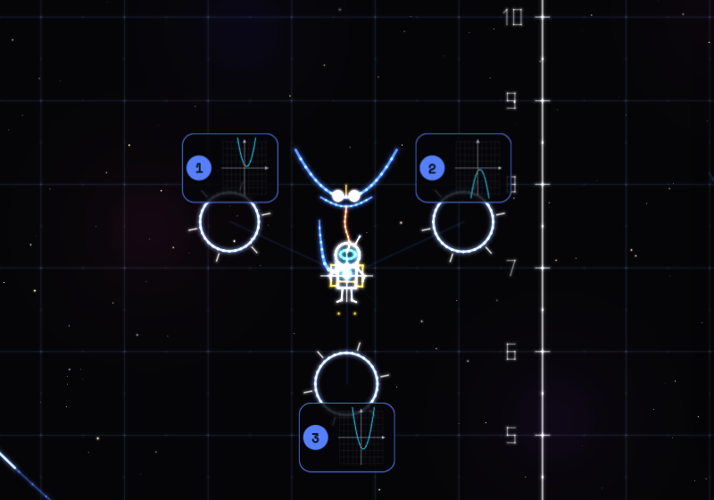

## Cosa è

AstroMath è un gioco di volo sul piano cartesiano. Si guida un piccolo pilota con lo zaino a razzo tra dodici costellazioni, in ordine di programma: numeri, percentuali e proporzioni, calcolo letterale, prodotti notevoli, scomposizioni, equazioni, rette, geometria, dati, radicali e secondo grado, parabola, e infine l'officina.

Ogni costellazione ha sei stelle. Avvicinandosi a una stella compare la sua creatura, disegnata con la matematica del suo argomento: la Manta parabolica ha le ali a forma di $y = ax^2$, la Squadra 3-4-5 apre i quadrati sui lati, il Quadrato del binomio si scompone in $a^2$, $2ab$ e $b^2$. La creatura fa una domanda, presa dai generatori della Quest, e attorno alla stella si aprono gli anelli delle risposte: si risponde fermandosi dentro l'anello giusto finché si riempie, oppure scegliendo la risposta e confermandola.

Non c'è un timer. Dopo due errori arrivano la spiegazione e un problema gemello con numeri nuovi. Quando tutte le stelle sono accese, la costellazione si disegna e in alto si apre il portale per la successiva. Ci sono anche le correnti: grafici di funzione con la loro formula scritta accanto, che portano chi li segue.

## L'idea matematica

Il cielo è un piano cartesiano vero, con gli assi numerati: ogni quadretto vale una unità. Le correnti sono funzioni, e la formula si controlla con gli occhi. Sulla corrente $y = \frac{1}{2}x + 2$, per $x = 4$ il pilota passa a quota $\frac{1}{2}\cdot 4 + 2 = 4$: basta guardare la griglia per verificarlo.

## Per prepararti alla verifica

- Ogni costellazione corrisponde a un argomento: completa quella della verifica senza usare il suggerimento.
- Alla fine trovi le lezioni della Quest su cui hai sbagliato in volo: parti da quelle.
- **Attenzione**: tra le risposte sbagliate ci sono gli errori più comuni, come dimenticare il doppio prodotto in $(a+b)^2$. Se una risposta "sembra quasi giusta", rifai il conto.

**Prova tu.** La parabola $y = (x - 2)(x - 4)$ taglia l'asse $x$ in $2$ e in $4$. Dove si trova il vertice?

Soluzione

Il vertice sta a metà tra gli zeri: $x_V = \frac{2 + 4}{2} = 3$. Sostituendo, $y_V = (3 - 2)(3 - 4) = 1 \cdot (-1) = -1$. Il vertice è $V(3;\,-1)$.

## Come usarla in classe

Proposta d'uso: alla LIM una persona pilota e la classe sceglie l'anello a voce, poi si controlla insieme la spiegazione. Sui telefoni si può far partire la stessa costellazione per tutti con lo stesso seme (`?seme=` nell'indirizzo), così le domande sono uguali e se ne discute dopo. Chi usa la Quest sullo stesso telefono trova d'oro le stelle già conquistate. Per allenarsi: **Numeri relativi**, **Percentuali**, **Prodotti notevoli**, **Equazioni di primo grado**, **Pendenza di una retta**, **Il teorema di Pitagora**, **Statistica**, **La parabola**.

## A cosa fare attenzione

- **Volare non è rispondere**: conviene fermarsi accanto alla stella, che tiene sospeso il pilota, e fare il conto prima di muoversi verso un anello.
- **Il suggerimento** toglie il bonus "a mente" ma non toglie punti: va usato senza paura quando serve.
