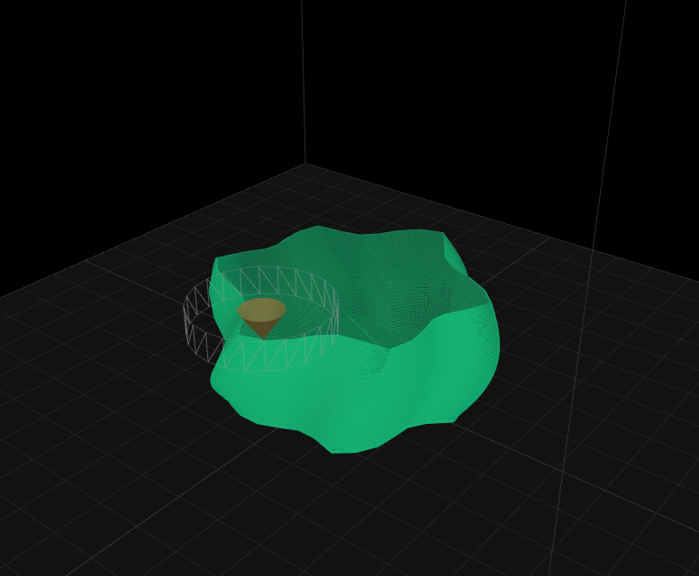
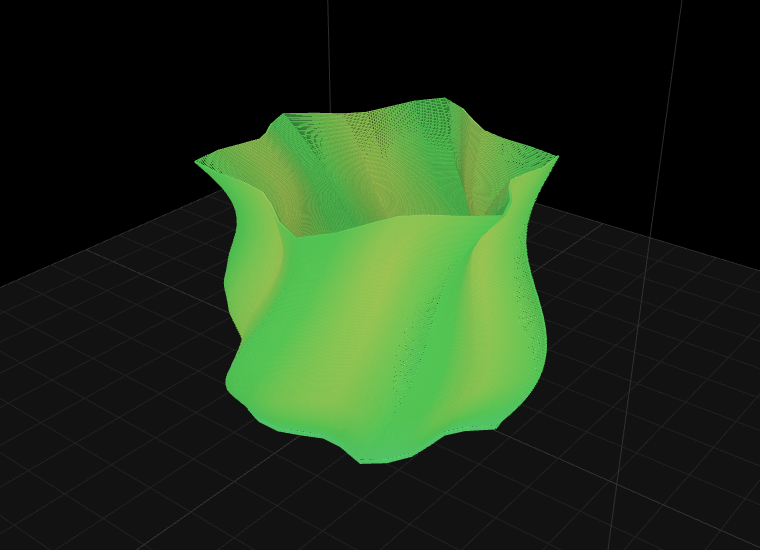

## Cosa è

Uno studio per progettare oggetti da stampare in 3D partendo dal **percorso** dell'ugello, invece che dalla forma. Si sceglie una forma di partenza: vaso, stella, spirografo, contenitore a vite, cupola, superficie ondulata, oppure un percorso disegnato a mano sul piatto. Poi la si modella con i cursori del pannello **Forma**. **Varia** propone una variante a caso, sempre stampabile.

La vista 3D mostra il filo come uscirà dall'ugello. Il cursore **Avanzamento stampa** fa rivedere la stampa dall'inizio, **Taglio in altezza** apre l'oggetto per guardarci dentro. A destra, il **Controllo stampa** dice se l'oggetto sta nella stampante e se l'ugello può seguirne il percorso. Sotto la vista ci sono il codice Python che genera il percorso, con la libreria FullControl, e il G-code. Il file finale si apre in Bambu Studio per A1 mini, A1 e P2S.

## L'idea matematica: punti in coordinate polari

Per un oggetto rotondo ogni punto del percorso si descrive con una **distanza** $r$ dal centro e un **angolo** $\theta$, poi si traduce per la stampante:

$$x = r\cos\theta, \qquad y = r\sin\theta.$$

Se il raggio cambia con l'angolo, il bordo si increspa: con $r = R + A\sin(6\theta)$ in un giro ci sono $6$ onde e il raggio va da $R - A$ a $R + A$. La parete del vaso è un **solo filo continuo**: a ogni giro sale di uno strato, quindi il percorso è un'elica.

**La pendenza per l'ugello.** Nelle forme "non planari" anche la quota oscilla, e il filo sale e scende lungo il giro. L'app calcola per ogni tratto l'angolo $\alpha$ con

$$\tan\alpha = \frac{\Delta z}{\Delta s},$$

dove $\Delta s$ è la strada fatta in orizzontale e $\Delta z$ la salita. Oltre $28°$ (su P2S $25°$) la punta dell'ugello urta il pezzo già stampato. È il triangolo rettangolo della trigonometria, usato come controllo di sicurezza.

**Il volume non cambia.** Per il vaso di partenza il pannello dice $46{,}2$ m di percorso ma $2{,}27$ m di filamento. Il filo da $1{,}75$ mm ha una sezione di circa $\pi \cdot 0{,}875^2 \approx 2{,}4$ mm²; la linea stesa è larga $0{,}5$ mm e alta $0{,}24$ mm, cioè $0{,}12$ mm²: venti volte più sottile, quindi venti volte più lunga: $46{,}2 : 20 \approx 2{,}3$ m.

## Per prepararti alla verifica

- Muovi il cursore delle onde e guarda il bordo: conta le onde in un giro e confrontale con il numero nella formula.
- Da sapere: $x = r\cos\theta$ e $y = r\sin\theta$; $\sin$ va da $-1$ a $1$, quindi $R + A\sin(n\theta)$ va da $R - A$ a $R + A$.
- **Attenzione**: la pendenza è un angolo, non un'altezza. Un'onda bassa ma stretta può essere più ripida di un'onda alta e larga.

**Prova tu.** L'ugello stende una linea larga $0{,}5$ mm e alta $0{,}2$ mm. Il filo ha una sezione di circa $2{,}4$ mm². Quanti metri di linea si ottengono da $1$ m di filo?

Soluzione

Sezione della linea: $0{,}5 \cdot 0{,}2 = 0{,}1$ mm². Il volume resta lo stesso, quindi la lunghezza cresce quanto si riduce la sezione: $2{,}4 : 0{,}1 = 24$. Da $1$ m di filo escono circa $24$ m di linea.

## Come usarla in classe

Una proposta alla LIM: si parte dal vaso e si porta **Avanzamento stampa** a metà. Prima di andare avanti si chiede alla classe come continua il filo: sale a scalini o in modo continuo? Poi si apre il pannello del codice e si cerca dove compaiono $\sin$ e $\cos$. Chi è più avanti può togliere la spunta "Rigenera dal pannello Forma" e cambiare a mano un numero nel codice.

Con i colori **Pendenza** e un'onda non planare sempre più ampia, la classe vede il vaso passare dal verde al rosso: si può chiedere di prevedere a quale ampiezza si supera il limite, e controllare.

Per allenarsi: **Goniometria**, **Trigonometria del triangolo rettangolo** e **Solidi e volumi** nella Quest. Le regole e cinque esercizi sono nella [scheda da stampare](/schede/fullcontrol_studio.html). Un altro modo di arrivare alla stampa partendo da una funzione: le [ruote che non sobbalzano](../2026-11-05-ruote-che-non-sobbalzano/).

## A cosa fare attenzione

- **Il primo avvio è lento**: l'app carica Python nel browser e servono internet e qualche secondo. Conviene aprirla prima di iniziare la lezione.
- **Un cursore alla volta**: le forme combinano profilo, superficie e onda; cambiandone tanti insieme non si capisce più che cosa ha fatto cosa.
- **Varia è casuale**: due studenti con lo stesso pulsante ottengono vasi diversi. È utile per discutere, meno per correggere lo stesso esercizio.
