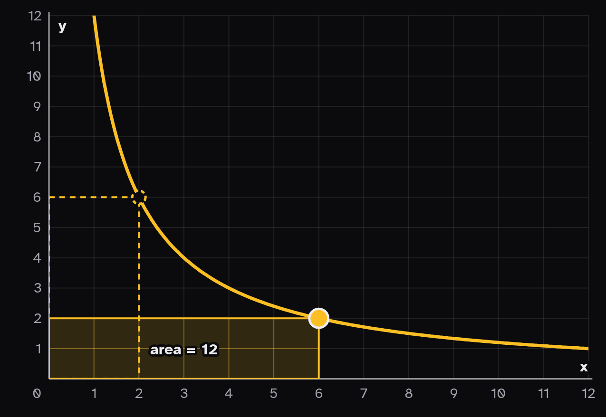

## Cosa è

Un laboratorio con un grafico su cui si trascina un punto e tre legami da confrontare: **diretta**, **inversa** e **lineare con quota fissa**. I pulsanti × 2, ÷ 2, × 3 e ÷ 3 cambiano la x, ma prima di mostrare il nuovo valore l'app chiede: secondo te, che cosa fa y? Il punto di prima resta tratteggiato, accanto alla tabella. Nei **Casi reali** ci sono situazioni di tutti i giorni e una per ogni laboratorio: ruote dentate, legge di Ohm, tessuto, stampa, gesso, porzioni.

Nella Quest arriva l'attività **Proporzionalità diretta e inversa**, con cinque livelli e numeri nuovi a ogni partita.

## L'idea matematica

La domanda giusta non è "y sale o scende?", ma **che cosa resta uguale**.

- **Diretta**: resta uguale il rapporto, $\frac{y}{x} = k$. Tre quaderni costano 6 €, sei quaderni 12 €: il doppio. Anche $k$ negativo va bene: con $y = -2x$ la y scende, da $-6$ a $-12$, ma raddoppia insieme a x.
- **Inversa**: resta uguale il prodotto, $x \cdot y = k$. Un rettangolo di area 12 può essere $2 \times 6$, $3 \times 4$ o $6 \times 2$: se la base raddoppia, l'altezza si dimezza.
- **Lineare**, $y = mx + q$: un taxi chiede 3 € alla partenza e 2 € al km. Con 1 km si pagano 5 €, con 2 km 7 €, non 10. La y non è proporzionale alla x. Però la proporzionalità diretta c'è, nascosta in due modi: tolta la quota fissa, $y - 3$ vale $2x$; e ogni km in più costa sempre 2 €, cioè $\Delta y = m \cdot \Delta x$.

## Per prepararti alla verifica

- Davanti a ogni problema fai il **test del raddoppio**: se la prima grandezza raddoppia, la seconda raddoppia, si dimezza o fa altro?
- Da sapere: diretta, valore per uno e poi moltiplichi; inversa, calcoli il prodotto e poi dividi.
- **Attenzione**: una retta che scende non è per forza inversa, e una retta che non passa per l'origine non è una proporzionalità tra x e y.

**Prova tu.** Una palestra costa 20 € di iscrizione più 5 € a ingresso. Quanto si paga con 4 ingressi? Con 8 ingressi si paga il doppio? Che cosa è proporzionale al numero di ingressi?

Soluzione

Con 4 ingressi: $20 + 5 \cdot 4 = 40$ €. Con 8 ingressi: $20 + 5 \cdot 8 = 60$ €, non 80: la quota fissa non raddoppia. Sono proporzionali agli ingressi la spesa senza iscrizione ($60 - 20 = 40 = 5 \cdot 8$) e gli aumenti: ogni ingresso in più costa sempre 5 €.

## Come usarla in classe

Alla LIM la previsione funziona come domanda per tutti: si preme × 2, la classe vota, poi si scopre il risultato. Il momento più utile è il confronto tra la diretta con $k$ negativo e la lineare con $m$ negativo: le due rette scendono entrambe, ma solo una passa per l'origine. Nella scheda **Allenati** ci sono sei domande da discutere, con la risposta da aprire alla fine.

A coppie, sui telefoni, ognuno sceglie un caso del proprio laboratorio e spiega all'altro che cosa resta uguale. Per allenarsi: **Proporzionalità diretta e inversa** e **Proporzioni** nella Quest.

## A cosa fare attenzione

- **"Scende, quindi è inversa"** è l'errore più frequente: conta che cosa resta uguale, non la direzione.
- **La quota fissa** fa sembrare proporzionale ciò che non lo è: provate sempre il doppio.
- **Nell'inversa il conto si fa con il prodotto**: $3$ operai in $8$ ore fanno $24$ ore di lavoro, quindi $6$ operai impiegano $4$ ore, non $16$.
