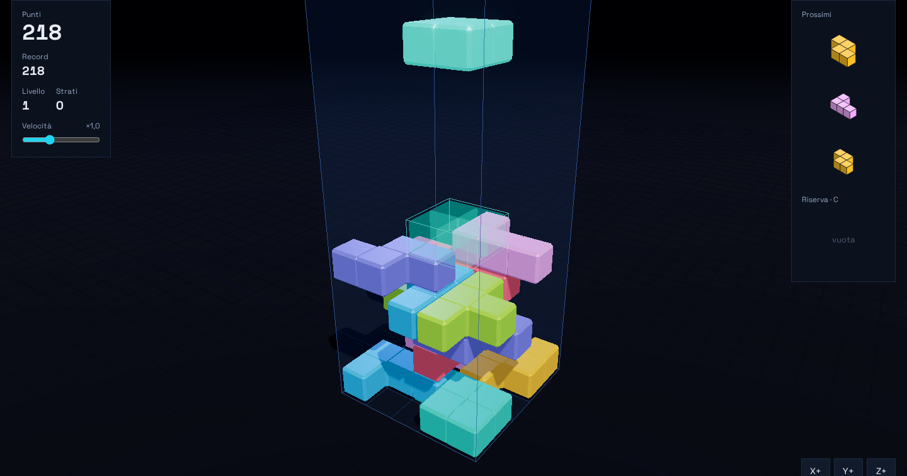
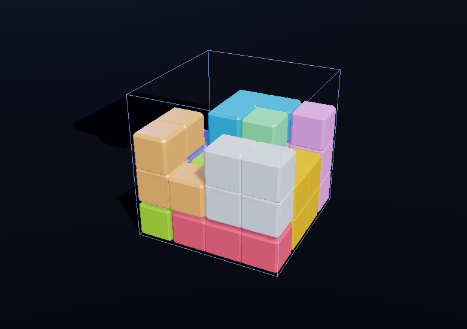
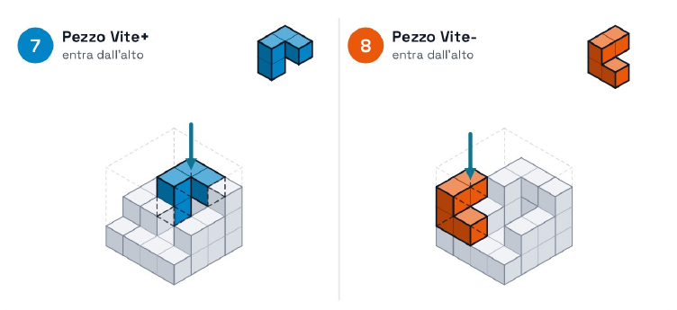
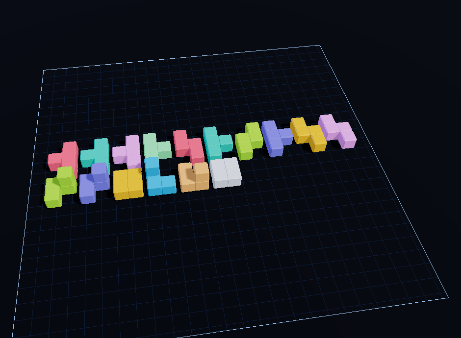

## Cosa è

Due attività nella stessa pagina.

- **Il gioco**: i sette tetramini, fatti di cubi, cadono in un pozzo a tre dimensioni. Si ruotano di 90° attorno a tre assi e si incastrano; uno strato pieno sparisce. Il pozzo può essere $5 \times 5$ o $7 \times 7$. La discesa è **automatica**, con un cursore che rallenta o accelera la velocità del livello raggiunto, oppure **guidata**: il pezzo resta fermo finché non lo si fa scendere, e c'è tutto il tempo per ruotarlo.
- **Il laboratorio "Un cubo in pezzi"**: si sceglie un solido (cubo $4 \times 4 \times 4$, blocchi $4 \times 4 \times 2$ e $4 \times 3 \times 2$, cubo $2 \times 2 \times 2$) e l'app lo divide a caso in pezzi da 4 cubetti. Un cursore smonta e rimonta il puzzle, un altro lo fa esplodere; la vista **Piatto** mostra i pezzi come usciranno dalla stampante. Il file 3MF si apre in Bambu Studio e si stampa senza supporti; il PDF delle **istruzioni** mostra passo per passo come rimontare il solido.
- **Il codice del set**: ogni set ha un codice, per esempio `444-7KQ2M`, che finisce nel nome del 3MF e del PDF. Riscrivendolo nel laboratorio si ritrova lo stesso set, con le stesse istruzioni.

## L'idea matematica: contare i cubetti

Un **tetracubo** è un pezzo di 4 cubetti uniti faccia contro faccia. Il conto del laboratorio è sempre in vista: $4 \cdot 4 \cdot 4 = 64 = 16 \cdot 4$. Un solido si divide in tetracubi solo se il numero dei suoi cubetti è un **multiplo di 4**: il cubo $3 \times 3 \times 3$ ha $27$ cubetti, e quindi non si può. È una condizione necessaria ma non sufficiente: il conto può tornare e l'incastro non esserci.

Il laboratorio non cerca la soluzione: parte dalla soluzione. Divide il solido e poi mescola i pezzi, quindi il puzzle si rimonta sempre. Per le istruzioni lo smonta al contrario: toglie ogni volta un pezzo che esce in linea retta senza urtare gli altri, cominciando dall'alto. Letta all'indietro, quella sequenza è il montaggio, e ogni pezzo entra dalla parte da cui era uscito.

**Girare nello spazio.** Nel piano i tetramini J e L sono uno lo specchio dell'altro, e nessuna rotazione li sovrappone. Nello spazio sì: basta capovolgere il pezzo, come si gira una pagina. Lo stesso vale per S e Z. Le due **Viti** del laboratorio invece restano diverse anche in 3D: sono speculari come la mano destra e la sinistra.

**Stampare senza supporti.** Ogni pezzo è un blocco pieno, appoggiato sul lato più piatto. Fra un cubetto e l'altro resta solo una scanalatura sottile, con le pareti inclinate di $45°$. La stampante costruisce ogni strato su quello sotto: su una parete a $45°$ ogni strato si sposta in fuori di quanto è alto, perché $\tan 45° = 1$. Con strati alti $0{,}2$ mm e un filo largo $0{,}4$ mm, metà del filo poggia ancora sullo strato sotto, e non servono supporti.

**Ingrandire.** I pezzi più alti escono dalla stampante alti $20$ mm, cioè il lato di un cubetto è circa $10$ mm. Se in Bambu Studio si raddoppia la scala, ogni lato raddoppia, ma il volume diventa $2^3 = 8$ volte più grande: otto volte la plastica e, più o meno, otto volte il tempo.

## Per prepararti alla verifica

- Nel laboratorio cambia il solido e leggi la prima riga dei dati: **cubetti = pezzi × 4**. Prova a prevedere il numero di pezzi prima di guardarlo.
- Il volume di un blocco si ottiene moltiplicando i tre lati, che siano in cubetti o in centimetri.
- **Attenzione**: raddoppiare i lati non raddoppia il volume. Le lunghezze si moltiplicano per $2$, le superfici per $4$, i volumi per $8$.

**Prova tu.** Un blocco $4 \times 4 \times 2$: quanti pezzi da 4 cubetti servono? Se in Bambu Studio raddoppi la scala di tutti i pezzi, quanti pezzi stampi? Quanta plastica serve rispetto a prima?

Soluzione

$4 \cdot 4 \cdot 2 = 32$ cubetti, $32 : 4 = 8$ pezzi. Con la scala doppia i pezzi restano $8$: cambia la loro grandezza, non il loro numero. Il volume di ogni pezzo diventa $2 \cdot 2 \cdot 2 = 8$ volte più grande, quindi serve circa $8$ volte la plastica.

## Come usarla in classe

Una proposta per iniziare: alla LIM si apre il laboratorio sul cubo $2 \times 2 \times 2$, il puzzle più piccolo, e si chiede alla classe quanti pezzi servono e perché sono uguali. Poi si passa al cubo $4 \times 4 \times 4$ e alla domanda del pannello: il cubo $3 \times 3 \times 3$ si può dividere in pezzi da 4? La risposta arriva contando, prima ancora di provare.

Il passo successivo è la stampa: secondo la stima dell'app, il set di sedici pezzi si stampa in meno di un'ora. Con il set si stampano le istruzioni, e il codice si scrive sul sacchetto: i gruppi si scambiano i set e rimontano il cubo seguendo i passi, poi provano senza istruzioni. Rimontare il cubo è un esercizio di visione spaziale, e il gioco allena la stessa abilità: ruotare un pezzo nella testa prima di farlo sullo schermo. Per chi comincia c'è la discesa guidata, che toglie la fretta.

Il filo con le altre attività: la scala che fa crescere il volume come il cubo del lato è il rovescio della [proporzionalità diretta](../2026-11-23-proporzionalita-che-cosa-resta-uguale/), perché il volume **non** è proporzionale al lato. Per un altro oggetto da stampare e far girare ci sono le [ruote che non sobbalzano](../2026-11-05-ruote-che-non-sobbalzano/). Le regole e quattro esercizi sono nella [scheda da stampare](/schede/tetracubi_3d.html). Per allenarsi: **Solidi e volumi** e **Proporzionalità diretta e inversa** nella Quest.

## A cosa fare attenzione

- **Il gioco tra i pezzi** è di $0{,}2$ mm alla dimensione proposta: con una stampante poco tarata i pezzi possono entrare a fatica. Conviene provare prima il cubo $2 \times 2 \times 2$.
- **Pezzi con la stessa forma sono uguali**: nelle istruzioni conta la forma, non il colore. Se un pezzo non entra, va girato come nel disegno piccolo accanto al numero del passo.
- **Il conto non basta**: che i cubetti siano un multiplo di 4 è necessario, non sufficiente. È un buon momento per distinguere le due parole.
- **Nel gioco le frecce si muovono rispetto alla camera**: se la vista ruota, cambia anche la direzione delle frecce, e all'inizio confonde.
